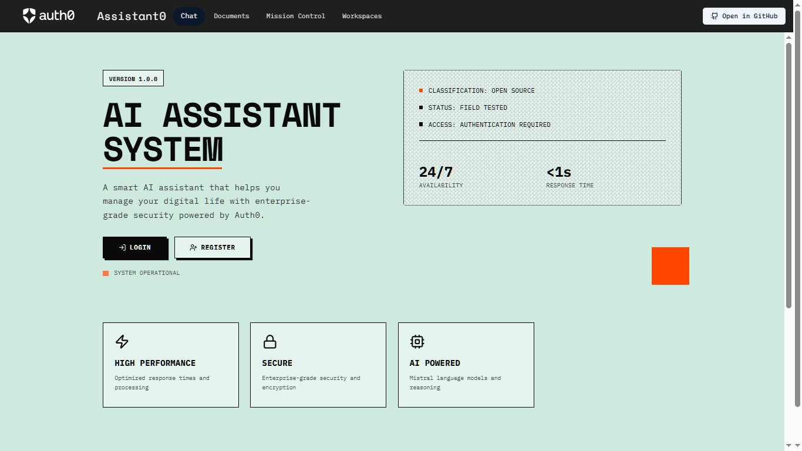

# Assistant0 - Auth0 Assistant Prototype

An Auth0 hackathon prototype for document retrieval, an audit dashboard, and connected assistant tools. Signed-in features require configured services. This is not a security certification, compliance product, or availability promise.

**[Fixture-only guest preview](https://assistant0agent.vercel.app/demo/index.html)** | **[Configured app](https://assistant0agent.vercel.app)** | **[Source](https://github.com/bO-05/assistantzero)**

> Built with Auth0 AI SDK, Next.js 15, Mistral AI, and Fine-Grained Authorization (FGA)

## ✨ What It Does

**Mission Control Dashboard** - Inspect application audit records and prototype risk classifications. Logging can fail; this is not proof of a complete audit trail or compliance.

**Risk-Adaptive Auth** - Prototype risk rules block flagged tools. A chat reply does not prove Auth0 step-up approval. Hosted step-up and provider behavior were not verified in the offline source checks.

**Workspaces** - Organize documents and application context. Workspace membership alone does not grant document access.

**Smart Document RAG** - Upload documents and chat with them using AI-powered semantic search with pgvector.

**Tool Integrations** - Configured Exa search, Gmail draft/search, calendar tools, and a commerce prototype. Real chat requires a session; it is separate from the disconnected guest preview.

## 🛠️ Tech Stack

**Frontend:** Next.js 15 (App Router), React 19, Tailwind CSS, shadcn/ui

**AI & Backend:** Vercel AI SDK v5, Mistral AI, Auth0 AI core v6 / Vercel adapter v5, Auth0 Next.js SDK v4

**Access integration:** Auth0 FGA, Token Vault, and prototype CIBA / step-up flows

**Database:** PostgreSQL via `DATABASE_URL`, Drizzle ORM, and pgvector. A specific hosted database and its live constraints were not independently verified in this source pass.

**Deployment:** Vercel

## 📂 Project Structure

```
src/
├── app/                    # Next.js App Router
│   ├── api/
│   │   ├── chat/          # Session boundary + lazily loaded streaming handler
│   │   ├── documents/     # Document upload API
│   │   └── migrate/       # Retired HTTP diagnostic (410), no database access
│   ├── page.tsx           # Main chat interface + landing page
│   ├── documents/         # Document management page
│   ├── mission-control/   # Audit trail dashboard
│   ├── workspaces/        # Workspace management
│   │   ├── [id]/         # Workspace detail page (dynamic route)
│   │   └── new/          # Create workspace page
│   ├── close/             # Session close page
│   ├── layout.tsx         # Root layout
│   └── globals.css        # Global styles
├── components/            # React components
│   ├── chat-message-bubble.tsx
│   ├── chat-window.tsx
│   ├── document-*.tsx     # Document management components
│   ├── auth0/             # Auth0 user components
│   ├── auth0-ai/          # Token Vault & Auth interruption flows
│   ├── guide/             # Info/guide components
│   └── ui/                # shadcn/ui components
├── lib/
│   ├── auth0.ts & auth0-ai.ts  # Auth0 SDK integration
│   ├── actions/           # Next.js server actions
│   ├── audit/             # Audit logging system
│   ├── db/                # Drizzle ORM schemas
│   ├── fga/               # Fine-grained authorization policies
│   ├── rag/               # Document embeddings & retrieval
│   ├── risk/              # Risk scoring system
│   ├── tools/             # AI agent tools (Exa, Gmail, Calendar, etc.)
│   └── workspaces/        # Workspace management logic
├── data/                  # Static data files
├── utils/                 # Helper functions
└── middleware.ts          # Auth0 authentication middleware
```

**How it works:**
1. Auth0 handles sign-in; private chat and document boundaries explicitly validate the session. Middleware alone is not an authorization guarantee.
2. Chat with AI at `/` → streams from `src/app/api/chat/route.ts` with tool interrupts
3. Upload docs at `/documents` → stored in PostgreSQL with pgvector embeddings
4. Inspect application records at `/mission-control` when logging and its database are configured
5. Manage contexts at `/workspaces`; document access remains explicitly per-document
6. AI tools auto-prompt for Google OAuth via Token Vault when needed

## 🚀 Quick Start

### Guest preview and review boundaries

`/demo/index.html` uses fictional public fixtures and preset responses. It makes no model, Gmail, database, or other service calls and does not read or write browser storage or cookies. It is not a hosted authorization test. Only its three exact asset paths bypass Auth0 middleware, with a CSP that forbids network connections and form submission. The legacy `NEXT_PUBLIC_DEMO` flag no longer opens model-backed guest chat.

Source checks cover document ownership, explicit verified-email sharing, foreign-workspace refusal, SQL-filtered retrieval before FGA, and anonymous upload/chat refusal. The 73 regression tests use embedded PGlite PostgreSQL fixtures and mocked providers. Constant fixture distance tests access predicates, not embedding quality. Share/delete controls are owner-only in the UI; server predicates remain the enforcement boundary.

Upload authentication runs before loading PDF-parser or persistence modules. Deployment tracing explicitly includes PDF workers and platform canvas files; regressions also cover initialization failures without disclosing private errors.

SQL and OpenFGA are not one transaction. Failed creation can leave remote tuples without a committed document; SQL access checks prevent reading such a document. Deletion revokes SQL access first and reports incomplete remote cleanup. OpenFGA idempotency options require a compatible configured service. No live tuple cleanup, model run, database migration, seed, provider write, or hosted sign-in proof is implied.

The reviewed dependency audit reports **0 critical, 2 high, and 23 moderate findings**. The two high entries are one underlying advisory, [GHSA-mrhx-c7xc-m3w5](https://github.com/advisories/GHSA-mrhx-c7xc-m3w5), affecting Auth0 AI's required Zod 3 dependency. Root Zod is patched, but that does not patch the SDK's nested copy. Authenticated chat has byte, collection, and depth limits before SDK validation. The dependency advisory remains unresolved; do not treat these limits as an upstream fix or this prototype as production-certified. No incompatible Zod override is forced.

The production-only dependency audit reports **0 critical, 2 high, and 5 moderate findings**. The production build passes with upstream AI/Auth0 dynamic-import and Edge compression API warnings. This is not proof of hosted Auth0 sign-in, DPoP, compressed-session, or provider compatibility. A synthetic one-page PDF exercises the installed parser API without uploading a document.

### 1. Clone the Repository
```bash
git clone https://github.com/bO-05/assistantzero.git
cd assistant0
```

### 2. Install the reviewed lock

Use Node **22.9 or newer** and the pinned npm release. Older npm 10.5.1 crashed resolving this dependency graph.

```sh
npm exec --yes --package=npm@11.21.1 -- npm ci --ignore-scripts --strict-peer-deps
npm test
npm run typecheck
npm run lint
```

Gmail uses the existing Google API client rather than the broad LangChain community dependency. Exa uses a bounded HTTPS search adapter. Their tests mock all provider traffic; no email delivery or live search result is claimed.

### 3. Set Up Environment Variables
Copy `.env.example` to `.env.local` and configure:

**Required:**
- `MISTRAL_API_KEY` - Get from [Mistral AI](https://console.mistral.ai)
- `AUTH0_DOMAIN`, `AUTH0_CLIENT_ID`, `AUTH0_CLIENT_SECRET` - Create app at [Auth0 Dashboard](https://manage.auth0.com)
- `AUTH0_SECRET` - Generate with `openssl rand -hex 32`
- `APP_BASE_URL` - `http://localhost:3000` (local) or your Vercel URL (production)
- `DATABASE_URL` - PostgreSQL connection string (recommended: [Neon](https://neon.tech) with pgvector enabled)
- `FGA_STORE_ID`, `FGA_CLIENT_ID`, `FGA_CLIENT_SECRET`, `FGA_API_URL`, `FGA_API_AUDIENCE`, `FGA_API_TOKEN_ISSUER` - Create FGA store at [dashboard.fga.dev](https://dashboard.fga.dev)

**Optional:**
- `EXA_API_KEY` - For enhanced web search ([exa.ai](https://exa.ai))
- `MISTRAL_CHAT_MODEL` - Override default model (default: `mistral-small-latest`)
- `MISTRAL_EMBEDDING_MODEL` - Override embedding model (default: `mistral-embed`)
- `AUTH0_CUSTOM_API_CLIENT_ID`, `AUTH0_CUSTOM_API_CLIENT_SECRET` - For async authorization/CIBA
- `AUTH0_AUDIENCE`, `AUTH0_SCOPE` - Custom API audience and scopes

📚 **Auth0 Setup Guides:**
- [Call Others' APIs on Users' Behalf](https://auth0.com/ai/docs/call-others-apis-on-users-behalf)
- [Call Your APIs on Users' Behalf](https://auth0.com/ai/docs/call-your-apis-on-users-behalf) (required for async auth)
- [Asynchronous Authorization](https://auth0.com/ai/docs/async-authorization) (optional)

### 4. Set Up Database (owner-approved target only)
These are manual setup instructions, not actions performed by the source checks. Confirm ownership and target, review migration SQL, and back up existing data before any database change. Do not run migration or FGA initialization commands during guest-preview QA.

**Option A: Neon (Recommended for Production)**
1. Use an existing owner-approved PostgreSQL database with pgvector.
2. Configure its connection string as `DATABASE_URL`.
3. Only after explicit target approval, apply reviewed migrations with `npm run db:migrate`.

**Option B: Local PostgreSQL**
1. Install PostgreSQL locally with pgvector extension
2. Create database: `createdb ai_documents_db`
3. Set `DATABASE_URL` in `.env.local`
4. Run migrations: `npm run db:migrate`

### 5. Initialize Auth0 FGA (owner-approved store only)
```bash
npm run fga:init            # Initialize FGA authorization model
```

After running `fga:init`, copy the generated `FGA_MODEL_ID` from console output and add it to `.env.local`.

### 6. Run Development Server
```bash
npm run dev
```

Open [http://localhost:3000](http://localhost:3000) and start chatting with your AI assistant!



## 🔧 Available Scripts

```bash
npm run dev          # Start development server
npm run build        # Build for production
npm run start        # Start production server (runs build first)
npm run lint         # Run ESLint
npm test             # Offline regressions, mocked providers
npm run typecheck    # TypeScript checks
npm run db:migrate   # Run database migrations
npm run db:studio    # Open Drizzle Studio (DB GUI)
npm run fga:init     # Initialize FGA authorization model

# Bundle analysis
ANALYZE=true npm run build
```

## 🤝 Contributing

This is a hackathon submission project. Feel free to fork and adapt for your own needs!

## 📄 License

MIT License - see [LICENSE](LICENSE) for the original Auth0 copyright and terms. Dependencies and service integrations retain their own licenses and terms.

## 🙏 Acknowledgments

Built upon the [Auth0 Assistant0 template](https://github.com/auth0-samples/auth0-assistant0/tree/main/ts-vercel-ai) by [Deepu K Sasidharan](https://github.com/deepu105).

Special thanks to the Auth0 team for their excellent AI SDK and documentation.

---

**Made with ❤️ for the Auth0 Hackathon Challenge**

